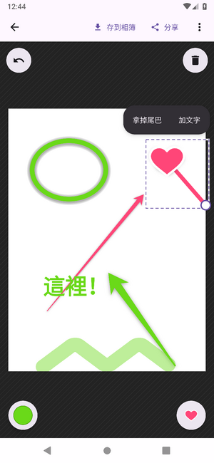
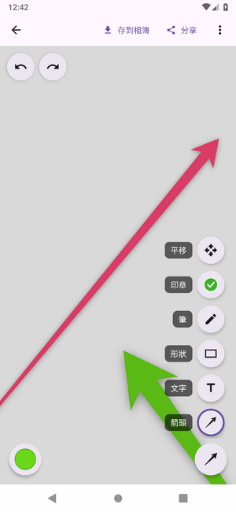
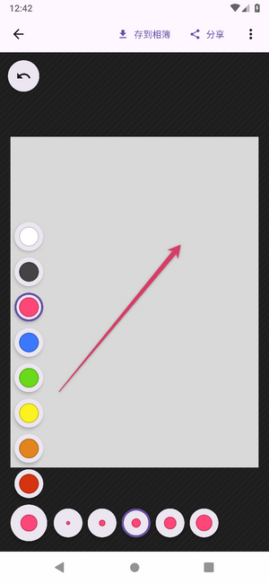
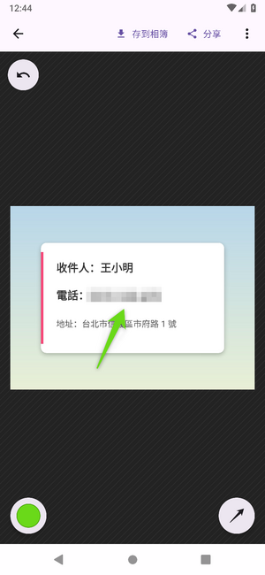
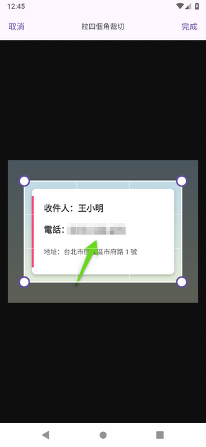
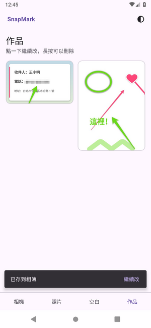
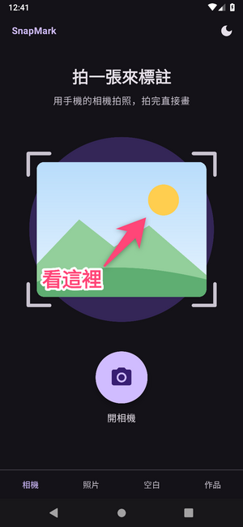

# SnapMark

在圖片上做標註的 Android App：拍一張照、選一張照片，或開一張空白畫布，
畫上箭頭、文字、方框、印章、馬賽克，再存到相簿或分享出去。

  

GitHub Actions 的 Android 9 模擬器錄影，加速 4 倍

## 功能

- **三個入口**：用系統相機拍一張、從手機選一張照片（也可以用自己慣用的相簿 App 選），或開一張空白畫布；
  也可以從別的 App「分享」圖片進來
- **標註**：箭頭、形狀（方框、圓角方框、直線、橢圓）、筆與螢光筆、文字、印章（打勾、問號、驚嘆號、愛心、叉叉），
  八種顏色、五種粗細
- **馬賽克**：照片上的電話、地址拉一個框就打碎
- **選取**：點一下畫好的東西，就能移動、改大小、改顏色、刪除
- **裁切、旋轉、清除標註**，兩指縮放平移，復原／重做
- **自動存檔**：標註過的圖都留在「作品」分頁，隨時打開繼續改
- **存到相簿或分享**：成品跟原圖一樣大；存好會回到作品分頁，按「繼續改」可以再打開
- **深色模式**：跟系統、淺色、深色
- **不連網、不需要帳號**：App 沒有 `INTERNET` 權限，照片不會離開手機
- Android 9 以上，Kotlin + Jetpack Compose

## 畫面

| 首頁 | 畫布 | 工具 | 顏色與粗細 |
|:---:|:---:|:---:|:---:|
|  |  |  |  |
| **馬賽克** | **裁切** | **存到相簿** | **深色模式** |
|  |  |  |  |

## 下載

[最新版 APK](https://github.com/twtrubiks/snapmark/releases/latest/download/snapmark.apk)

## 開發

在 [claude.ai/code](https://claude.ai/code) 雲端 session 開發，畫面靠 GitHub Actions 的模擬器錄影確認。
進度看 [`CLAUDE.md`](CLAUDE.md) 的「目前的狀態」。

- 規格、架構、約定：[`CLAUDE.md`](CLAUDE.md)
- 雲端環境設定：[`docs/cloud-setup.md`](docs/cloud-setup.md)
- 發版金鑰：[`docs/release-key.md`](docs/release-key.md)

⭐ **如果這個專案對您有幫助，請給一個 Star！** ⭐

## Donation

文章都是我自己研究內化後原創，如果有幫助到您，也想鼓勵我的話，歡迎請我喝一杯咖啡 :laughing:

綠界科技ECPAY ( 不需註冊會員 )

[贊助者付款](http://bit.ly/2F7Jrha)

歐付寶 ( 需註冊會員 )

[贊助者付款](https://payment.opay.tw/Broadcaster/Donate/9E47FDEF85ABE383A0F5FC6A218606F8)

## 贊助名單

[贊助名單](https://github.com/twtrubiks/Thank-you-for-donate)
